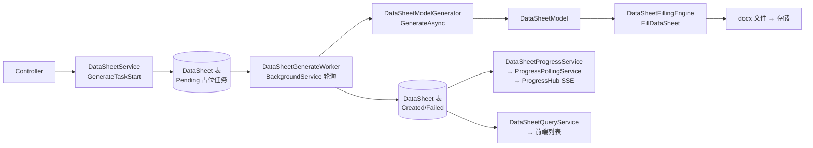
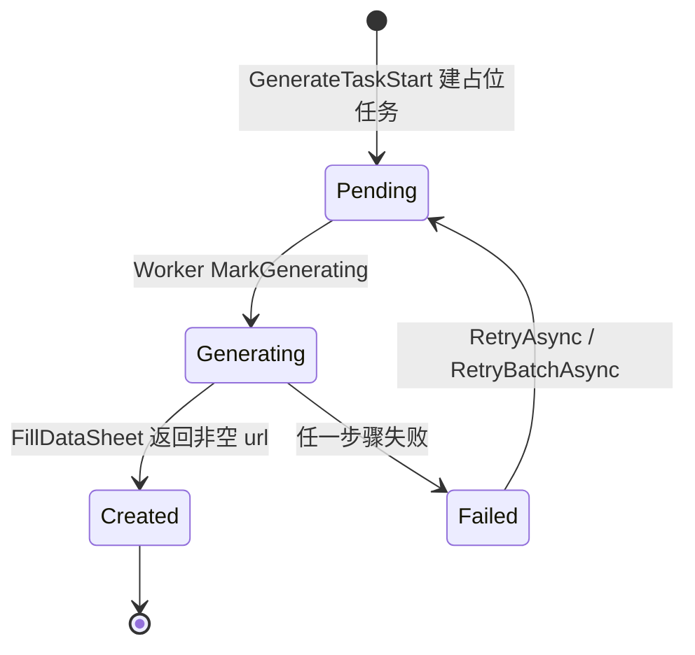

# DataSheetContext — 数据单（DataSheet）应用服务层

> 本文件是**该目录的协作入口文档**。任何人（含 AI）接手本目录前请先读完本文档，
> 即可掌握：目录职责、每个类的契约、上下游链路、生成流水线、已知缺陷与修复建议。
>
> 配套文档：`src\Infrastructure\TemplateEngine\WordTemplateAdapter\AGENTS.md`
> （下游填充层，本目录的 `DataSheetModel` 就是它的输入）
>
> 最后更新：基于 `bc627f0`（本轮按源码逐类核对 §1/§2/§6，详见文末 §10 修改日志）

---

## 0. 一句话定位

**把「检测清单（CheckList）」拆解成「数据单任务（DataSheet）」，异步生成 DataSheetModel，
再交给 Word 模板引擎产出 docx 文件，并对外提供状态查询 / 进度推送 / 编辑回调。**

本目录是**异步任务编排层**：请求进来只落库排队，真正的生成由后台 Worker 消费。
所以这里大量出现 `Pending / Generating / Failed / Created` 状态机、幂等、重试、并发恢复。
（注：成功态的枚举成员实际叫 **`DataSheetStatus.Created`**；下文/旧图里的 `Success` 均为同一语义，详见 §6.13。）

### 本目录在整条链路中的位置



---

## 1. 目录文件清单

| 文件 | 行数 | 类型 | 生命周期 | 一句话职责 |
|---|---|---|---|---|
| `DataSheetService.cs` | 308 | 应用服务 | `IScopedDependency` | **对外入口**：启动生成任务、重试、ONLYOFFICE 回调、标记完成/审批 |
| `DataSheetGenerateWorker.cs` | 338 | 后台任务 | `BackgroundService` | **生成流水线**：轮询 Pending → 生成模型 → 填模板 → 落状态 → 回写模板 URL |
| `DataSheetModelGenerator.cs` | 433 | 领域编排 | `IScopedDependency` | **模型工厂**：CheckList → 参数分包 → 选模板 → `DataSheetModel` |
| `DataSheetQueryService.cs` | 43 | 查询服务 | `IScopedDependency` | 按 CheckListId 查 DataSheet 列表（Mapster 映射为 DTO） |
| `DataSheetProgressService.cs` | 123 | 查询服务 | `IScopedDependency` | 汇总进度快照（`IDistributedCache`，TTL 0.5s） |
| `DataSheetProgressHub.cs` | 45 | 推送薄壳 | **`ISingletonDependency`** | 转发到通用 `ISseHub`（频道 `datasheet`），仅保留 `Guid` ↔ `string key` 转换 |
| `DataSheetProgressSnapshotProvider.cs` | 约 175 | 快照提供者 | **`ISingletonDependency`** | DataSheet 链路接入通用推送的**唯一适配点**：取快照 + 算哈希 + 终态判定 |
| `DataSheetProgressPollingService.cs` | 约 30 | **已停用** | — | 轮询已移交 `Application\Service\Realtime\ProgressPollingService`，本类仅留空壳与迁移线索 |

> 注意：`DataSheetProgressHub` 与 `DataSheetProgressSnapshotProvider` 是 **Singleton**，
> 其余都是 Scoped。Worker 因此必须靠 `IServiceScopeFactory` 自建 scope。

---

## 2. 逐类详解（含入参协议）

### 2.1 `DataSheetService` — 对外入口

**依赖注入**（9 个，构造函数 L31-52）：
`IUnitOfWork`、`ICheckListRepository`、`IConditionPoolRepository`、`DataSheetFillingEngine`、
`ILogger<DataSheetService>`、`IDataSheetRepository`、`IWebHostEnvironment`、
`IFileStorageService`、`IDataSheetBatchRepository`

> 已移除 `IDataSheetModelGenerator`：本类 308 行内**零调用点**（代码确证），属死注入。
> 之所以原先注入它，是因为生成职责曾计划下放到本类；实际全部由 `DataSheetGenerateWorker` 承担。

| 方法 | 入参 | 出参 | 行为要点 |
|---|---|---|---|
| `GenerateTaskStart` | `DataSheetGenerateDto dto`、`CancellationToken ct` | `Task<Result<GenerateDataSheetTaskResult>>` | L62 |
| `RetryAsync` | `Guid dataSheetId`、`CancellationToken ct` | `Task<Result>` | L130 |
| `RetryBatchAsync` | `CheckListId checkListId`、`CancellationToken ct` | `Task<Result>` | L160 |
| `SaveFromOnlyOffice` | `string datasheetId`、`string url`、`CancellationToken ct` | `Task` | L187 |
| `MarkDone` | `Guid datasheetId`、`CancellationToken ct` | `Task<Result>` | L271 |
| `MarkApproved` | `string datasheetId`、`string url`、`CancellationToken ct` | `Task<Result>` | L293 |

**`GenerateTaskStart` 五步**（L62-122）：

1. 校验 CheckList 存在且 `Status == InProgress`，否则 `throw ArgumentException`；
2. **幂等**：`dto.ForceRegenerate == false` 时查 `GetActiveByCheckListIdAsync`，
   有未失败批次直接返回其 `(BatchId, CheckListId, Total)`；
3. 模板 URL —— **请求阶段不再硬编码**：`contactTemplateUrl = string.Empty`（L87-91）。
   原硬编码值 `"DocxModel/Common_WET/WET_Dimensional_Change_Wasing.docx"` 已移除，
   理由是它不符合 `Template.BuildFileName` 的命名约定（缺前导 `/`、缺 `_v{n}_{时间戳}`），
   盘上也无同名文件，一旦真被 `CopyTemplate` 使用即为必现故障。
   真实模板 URL 由 `DataSheetModelGenerator` 按完整条件选出，Worker 阶段经 `DataSheet.BindTemplate` 回写；
4. `DataSheetBatch.Create(...)` 建批次（`Total = checklist.Items.Count`）；
5. 按 `checklist.Items` 拆 N 个 **`Pending` 占位 DataSheet**（`modelIndex: 0`）。

> ⚠️ L117 明确注释：**不在这里生成文件、不推送**。所有生成工作都交给 Worker。
> 这是「请求快速返回」的关键设计，改代码时不要图省事在 Service 里同步生成。

**重试语义**：`RetryAsync` 只允许 `Failed → Pending`（状态不对返回 `Result.Fail`）；
`RetryBatchAsync` 走 `BulkMarkPendingAsync`，影响 0 行则回滚并返回失败。

**`SaveFromOnlyOffice` 幂等**：L199-200 有一段被注释掉的幂等逻辑
（注释原文「报错代码：后续用其他方式幂等」），说明该处幂等**当前是缺失的**，
重复回调会重复处理。见 §6.5。

---

### 2.2 `DataSheetGenerateWorker` — 生成流水线

**依赖注入**：`IServiceScopeFactory`、`ILogger<DataSheetGenerateWorker>`

| 方法 | 入参 | 出参 | 说明 |
|---|---|---|---|
| `ExecuteAsync` | `CancellationToken ct` | `Task` | 主循环，`while(!ct.IsCancellationRequested)` |
| `GenerateOne` | `DataSheet ds`、`List<ConditionPool> pools`、`IDataSheetModelGenerator`、`DataSheetFillingEngine`、`IDataSheetRepository`、`ICheckListRepository`、`IUnitOfWork`、`CancellationToken ct` | `Task` | 单个任务全流程（含事务） |
| `ExpandPendingTasks` | `DataSheet origin`、`IReadOnlyList<DataSheetModel> models`、`IDataSheetRepository`、`IUnitOfWork`、`CancellationToken ct` | `Task` | index=1..N-1 展开 |
| `IsTransient` | `Exception ex` | `bool` | 判可重试 |
| `IsUniqueViolation` | `DbUpdateException ex` | `bool` | SQL Server 2601/2627 |
| `ResolveModelKey` | `DataSheetModel model`、`int index` | `string` | `model.ModelKey` 或 `__index_{i}` |

**主循环 `ExecuteAsync`（L37-109）**：

```
每 1 秒一轮：
  CreateScope → 取 repo/generator/engine/poolRepo/uow/checklistRepo
  GetPendingAsync(batchSize: 20)          // 空则 Delay 1s continue
  按 CheckListId 分组 → 批量预取 ConditionPool（避免 N+1）
  Parallel.ForEachAsync(ids)：
      每个任务 CreateScope 独立 scope      // ★ 避免 DbContext 并发访问
      内层重新 GetByIdAsync 载入 ds         // ★ 不跨 scope 操作实体
      GenerateOne(...)
  catch(Exception) → LogError，不中断循环
  Delay 1s
```

**两个 ★ 是本类最重要的设计约束**：`IDataSheetRepository` 背后是 DbContext，
Scoped 且非线程安全，所以并行度靠「每任务一个 scope」实现，而不是共享实例。

**`GenerateOne` 全流程（L122-267，事务包裹）**：

1. `BeginTransactionAsync` → `ds.MarkGenerating()` → `UpdateAsync` + `SaveChangesAsync`
   （注释 ★「让 EF 跟踪变更」，不能省）；
2. 取 checklist → 为空 → `MarkFailed("CheckList not found", retryable: false)` + 提交返回；
3. 按 `TestItemId` 取 checklist item → 为空 → `MarkFailed("ChecklistItem not found", retryable:false)`；
4. **解析模型，优先读快照**：
   - `ds.ModelSnapshot` 非空 → 直接 `JsonSerializer.Deserialize<DataSheetModel>`（**不重复生成**）；
   - 否则调 `modelGenerator.GenerateAsync(pools, item, ct)`；
     - 结果为空 → `MarkFailed("Model generation returned empty", retryable:false)`；
     - 绑定 index=0 的 model → `ds.BindModel(key0, json)`；
     - `allModels.Count > 1` → `ExpandPendingTasks` 展开其余；
   - 快照与生成两路都拿不到模型 → `MarkFailed("Model resolved to null", retryable:false)`（L196-203）；
4.5 **模板回写**（L205-212）：`myModel.TemplateUrl` 非空且与 `ds.ContactTemplateUrl` 不相等时
   调 `ds.BindTemplate(myModel.TemplateUrl)`。
   注释明确「批次/占位任务上的 URL 只是请求阶段的粗值」——快照缺 `TemplateUrl` 的历史任务不会被判失败；
5. `fillingEngine.FillDataSheet(myModel)` 产出文件 URL；
   - 空 URL → `MarkFailed("FillDataSheet returned empty url", retryable:false)`；
   - 否则 → `MarkSuccess(fileUrl)`；
6. `UpdateAsync` + `SaveChangesAsync` + `CommitAsync`
   （注释 ★「一次 SaveChanges：展开 + 状态变更一起提交」）。

**异常恢复策略**（两段，均 rollback + **新建独立 recovery scope** 重新加载 latest 再写，
避免使用已失败的实体/上下文）：

| 异常 | 处理 |
|---|---|
| `DbUpdateException` 且 `IsUniqueViolation` | 若 latest 仍为 `Generating` → `MarkFailed("Concurrent expand detected, will retry", retryable: true)` |
| 其它 `Exception` | `retryable = IsTransient(ex)` → latest `MarkFailed(ex.Message, retryable)` |

**`ExpandPendingTasks`（L269-310）**：只允许在 `origin.ModelIndex == 0` 时调用
（否则记 Warning 直接返回）；`i = 1..N-1`；先用 `ExistsAsync(checkListId, testItemId, i)` **幂等**跳过已存在；
再 `DataSheet.Create(..., modelIndex: i)` + `BindModel`。**AddAsync 不 SaveChanges**，
由调用方 GenerateOne 统一提交。

> 新任务的 `contactTemplateUrl` 取的是**各 model 自己的** `model.TemplateUrl`（L299），
> 不是 origin 的粗值 —— 同一个 CheckListItem 展开出的多份数据单，模板可能因参数包不同而不同。

**`IsTransient`**：`TimeoutException` / `IOException` / 消息含 `"503"` / 含 `"timeout"`（不区分大小写）。

> 这套「占位任务 + 模型快照 + 幂等展开」的组合，实质是把 **1 个 CheckListItem → N 个 DataSheet**
> 的扇出做成了**数据库驱动的队列**：第一次跑的 index=0 任务负责发现 N 并补建其余任务，
> 之后的每个任务只从自己的 `ModelSnapshot` 反序列化，不再重复调 `GenerateAsync`。

---

### 2.3 `DataSheetModelGenerator` — 模型工厂（重点）

> **分层现状（本次改造后）**：本类已退化为薄壳。
> - 纯计算规则 → `IDataSheetModelDomainService`（`src\Domain\Services\DataSheetContext`，零仓储依赖）；
> - 模板索引匹配 + testcondition 文本填充 → `ITestConditionComposer`
>   （`src\Application\Service\TemplateConditionContext`，**与 checklist 侧共用同一实现**）。
>
> 两条链路共享节点的关系：
> ```mermaid
> flowchart LR
>     DS["DataSheetModelGenerator<br/>(datasheet)"] --> TC["ITestConditionComposer"]
>     CL["CheckListTestParamResolver<br/>(checklist)"] --> TC
>     TC --> T["ITemplateSelectService / Template.FindTextTemplate / TextReplaceHelper"]
> ```
> 因此同一 checklist 生成的 datasheet 与 checklist，其 testcondition 文本必须一致。

这是 `DataSheetFillingEngine.FillDataSheet(DataSheetModel)` 的**唯一上游**，
也是本次链路追溯的焦点。

**依赖注入**：`IStandardRepository`（查标准）、`ITemplateSelectService`（选模板）、
`IDataSheetModelDomainService`（**领域规则委托**，实现位于 `src\Domain\Services\DataSheetContext\DataSheetModelDomainService.cs`）

> 分层定位（重构后）：本类是**应用层编排薄壳**。只负责取池、选池、查标准、拼
> `runtimeConditions`、选模板与组装 `DataSheetModel`；所有跨聚合的纯计算规则已下沉领域层。

**入口协议**（接口 `src\Application\Interface\IDataSheetModelGenerator.cs`）：

```csharp
Task<List<DataSheetModel>> GenerateAsync(
    List<ConditionPool> pools,     // 该 CheckList 下所有条件池
    CheckListItem item,            // 本次要生成的检测项
    CancellationToken ct);
```

`pools` 是 **List**、返回也是 **List** —— 因为一个 item 会按参数分包
（`TestPointPackage`）产出**多份** DataSheetModel，每份对应一张数据单。

| 方法 | 入参 | 出参 | 去向 | 职责 |
|---|---|---|---|---|
| `GenerateAsync` | `List<ConditionPool>`、`CheckListItem`、`CancellationToken` | `Task<List<DataSheetModel>>` | **保留在本类** | 应用层编排：分包→选池→调 `ITestConditionComposer`（合成条件 + 选模板）→组装模型 |
| `PackByParamSet` | — | — | 已下沉 `IDataSheetModelDomainService` | 参数分包（分组键剔除 `WashCycle`） |
| `CalculateDataAreaCount` | — | — | 已下沉 `IDataSheetModelDomainService` | 数据区格数 |
| `ExpandSampleArray` / `ExpandAfterWashArray` | — | — | 合并为领域层 `ExpandByWashCycle(..., WashDataKind)` | 按水洗次数展开 |
| `CalcuteSampleMapAsync` / `CalculateAfterWashMapAsync` | — | — | 合并为领域层 **同步** 方法 `BuildBookmarkMap(...)` | 书签映射 + `IsAppend` |
| `ExtractString` / `ExtractInt` | `object? raw` | `string` / `int` | **保留在本类**（`private static`） | `ReportNumber` / `SheetCount` 的安全取值，属应用层组装职责 |
| `ToSampleMap` / `ToAfterWashMap` | `BookmarkMapResult` | `SampleMap` / `AfterWashMap` | **新增在本类**（`private static`） | 把领域层结果适配为实体契约 |

> 旧方法名（`CalcuteSampleMapAsync` 等）在本类已**删除**，`IDataSheetModelGenerator`
> 只暴露 `GenerateAsync`（`src\Application\Interface\IDataSheetModelGenerator.cs:16`），
> 故删除对外部调用方零影响。

#### DataSheetModel 字段来源映射（改字段必看）

| 字段 | 取值来源 | 说明 |
|---|---|---|
| `ReportNumber` | `pool.Conditions["ReportNo"]` → `ExtractString` | 缺失则空串 |
| `SheetCount` | `pool.Conditions["Copy"]` → `ExtractInt(default: 1)` | 数据单份数 |
| `DataAreaCount` | `CalculateDataAreaCount(item, package)` | 见下 |
| `TemplateUrl` | `composition.Template.GetTemplateUrl()` | `composition` 来自 `ITestConditionComposer.ComposeForPackageAsync`；模板索引匹配（`preFilterKey: "TestItemId"`）已下沉公共组件，本类不再自行拼 `runtimeConditions` |
| `TestItem` | `item.TestItemId` | |
| `TestMethod` | `standards` 按 `Id.Value`（`OrdinalIgnoreCase`）排序后取 `StandardCode ?? StandardCodeNameEn ?? Id.Value`，`;` 拼接 | 查不到则降级用 `item.StandardIds`。**必须先排序**（L76-77 注释）：`TemplateIndex` 的 `MatchesAll` 是逐字比对，依赖 DB 返回顺序会拼出 `"A;B"`/`"B;A"` 造成**索引匹配漂移** |
| `TestCondition` | `composition.Text` | 由 `ITestConditionComposer.ComposeText` 产出；**文本模板匹配用原始 `pool.Conditions`**（不是运行时条件），该口径已被方法签名强制 |
| `SampleMap` | `CalcuteSampleMapAsync(...)` | 书签 `Sample_data_1`、`Sample_data_2`… |
| `AfterWashMap` | `CalculateAfterWashMapAsync(...)` | 书签 `After_wash_data_1`… |

#### 选模板前的条件组装协议（L57-100）

`GenerateAsync` 不是拿 `pool.Conditions` 直接选模板，而是先拼一份运行时条件字典：

```csharp
var runtimeConditions = new Dictionary<string, object?>(pool.Conditions);  // 克隆，避免并发污染
// 合并参数包
foreach (var kv in package.ParamSet.Values.ToDictionary()) runtimeConditions[kv.Key] = kv.Value;
// 追加两项派生条件
runtimeConditions["TestItemId"] = item.TestItemId!.Value;
runtimeConditions["TestMethod"] = testMethod;
var template = _templateSelectService.FindByIndex(runtimeConditions, preFilterKey: "TestItemId");
```

- `preFilterKey: "TestItemId"` 是**初筛键**：先按检测项缩小子集，再对剩余候选做逐条比对；
- 克隆字典是刻意的：`pool.Conditions` 属于共享的 `ConditionPool` 实体，直接往里写会污染同批次其它参数包；
- **参数包与条件池的匹配规则是「全包含」**（L49-55）：`target.All(x => p.TestPoints.Contains(x))`，
  即 pool 的 `TestPoints` 必须覆盖该包所有测点；找不到则 `continue` **静默跳过该包**（不抛异常、不记日志）。

#### 三个核心算法

**① 参数分包 `PackByParamSet`（L142-177）**

按 `item.TestPointParams` 的 **ParamSet 值**分组，但分组键**必须先剔除 `WashCycle`**：

```csharp
// 「水洗次数不同不影响参数合并」——所以判等时排除 WashCycle
if ("WashCycle".Equals(v.Key, StringComparison.OrdinalIgnoreCase)) continue;
var key = JsonConvert.SerializeObject(filteredValues);
```

分组后 `Select(g => new TestPointPackage(TestPointIds: 排序后的测点 ID, ParamSet: g.First().Value))`
—— **保留原始 ParamSet（含 WashCycle）**，只用过滤后的键做聚合。
最终按 `TestPointIds.First()` 排序，保证输出顺序稳定。

> 这个「分组键排除某字段，但聚合体保留该字段」的手法，是全文件最容易读错的地方。

**② 数据区计数 `CalculateDataAreaCount`（L185-221）**

对 `package.TestPointIds` 逐个测点累加：
- 无参数配置 → `+1`；
- 有 `WashCycle` 且为 string（格式 `"1-2-32-45"`）→ 按 `-` 分割，**段数**即个数；
- 无 `WashCycle` → `+1`。

**③ 书签映射 `CalcuteSampleMapAsync`（L260-299）**

```
sampleDataCount = template.TemplateStructure.SampleDataAreaCount   // 模板预留格数
samplemap 为空或 Length == 0  → 直接 return new SampleMap()        // 不再二次调用 CalculateDataAreaCount
否则  Sample_data_{i+1} = samplemap[i]
IsAppend = sampleDataCount > 0 && samplemap.Length > sampleDataCount   // 严格大于；相等时刚好填满，不复制
```

> `IsAppend` 的两个细节容易读错：
> 1. 是 **`>`（严格大于）**，不是 `>=` —— 测点数等于预留格数时不复制 data 表；
> 2. 前面必须带 `sampleDataCount > 0`：`TemplateStructure` 无初始化器、工厂只校验 `< 0`，
>    未配置时该值为 0，若直接比较则 `IsAppend` 恒为 `true`。

`AfterWashMap` 同构，但**前缀判断不同**：先看 `template.TemplateStructure.AfterWashDataCount <= 0`
就直接返回空（模板没这块就不生成），键为 `After_wash_data_{n}`，
`IsAppend = afterWashDataCount > 0 && afterWashArray.Length > afterWashDataCount`（L333）。

---

### 2.4 `DataSheetQueryService`

**依赖**：`IDataSheetRepository`

| 方法 | 入参 | 出参 |
|---|---|---|
| `GetDataSheetByChecklistId` | `Guid checklistId`、`CancellationToken ct` | `Task<Result<List<DataSheetResponseDto>>>` | L26-40 |

纯读，无副作用。给前端列表页用。内部用 Mapster `Adapt<List<DataSheetResponseDto>>()` 投影（L32），
异常不外抛而是 `Result.Fail(ex.Message)`（L36-39）。

---

### 2.5 `DataSheetProgressService`

**依赖**：`IDataSheetRepository _dsRepo`、`IDataSheetBatchRepository _batchRepo`、`IDistributedCache _cache`

| 方法 | 入参 | 出参 | 说明 |
|---|---|---|---|
| `GetSnapshot` | `CheckListId checkListId`、`CancellationToken ct` | `Task<DataSheetProgressDto>` | 汇总进度，带分布式缓存 |
| `ComputeOverallStatus` | `List<DataSheet> items`、`DataSheetBatch? batch` | `string` | 推导整体状态 |
| `ToItemDto` | `DataSheet ds` | `DataSheetItemDto` | 单条映射 |

`IDistributedCache` 把快照缓存在 key `datasheet:progress:{checkListId}`（L37），
**TTL 仅 0.5 秒**（`AbsoluteExpirationRelativeToNow`，L67）—— 目的是在多个订阅者/多实例之间合并同一轮查询，
而不是持久缓存；改快照结构时无需担心旧缓存长期不失效。

两个需要注意的实现事实：
1. `Success` 字段统计的是 **`DataSheetStatus.Created`**（L53、L84），不是叫 `Success` 的枚举值；
2. `ComputeOverallStatus` 的 `batch` 参数**从未被使用**（L80-98），整体状态完全由 `items` 计数推导。

---

### 2.6 `DataSheetProgressHub`（Singleton，**迁移期兼容薄壳**）

> 推送逻辑已泛化到 `src\Application\Service\Realtime\`，本类不再持有连接表，也不再算哈希。
> 保留它只为让 `DataSheetController` 的调用形态稳定，避免一次性改动过大。

**依赖**：`ISseHub`（通用推送枢纽）

| 方法 | 入参 | 出参 | 说明 |
|---|---|---|---|
| `RegisterAsync` | `Guid checkListId`、`ISseClient client`、`CancellationToken ct` | `Task` | 转发 `ISseHub.RegisterAsync("datasheet", key, client, ct)` |
| `UnregisterAsync` | `Guid checkListId`、`ISseClient client` | `Task` | 转发 `ISseHub.UnregisterAsync` |
| `GetActiveCheckListIds` | — | `IReadOnlyCollection<Guid>` | 转发 `ISseHub.GetActiveKeys("datasheet")` 并解析回 Guid；诊断用途 |

**原职责去向**（不要再往本类里加回来）：

| 原成员 | 现在在哪 |
|---|---|
| `_emitters` / `_lastSnapshotHash` / `Dead` 清理 | `SseHub`（`Application\Service\Realtime`） |
| `ComputeHash`（硬编码 DataSheet 字段） | `DataSheetProgressSnapshotProvider.ComputeHash`（逐字复刻原口径） |
| `HasChanged` / `Broadcast` / `CloseAll` | 由 `ProgressPollingService` 直接调 `ISseHub`，本类已删除这三个方法 |

> ⚠️ 连接表与哈希去重已不是本类维护。看推送行为请去 `Application\Service\Realtime\AGENTS.md`。

---

### 2.7 `DataSheetProgressSnapshotProvider`（Singleton，**链路唯一适配点**）

实现 `IProgressSnapshotProvider`（契约在 `src\Application\Contract\Realtime\`），频道固定 `"datasheet"`。

**依赖**：`ISseHub`、`IServiceScopeFactory`、`ILogger<DataSheetProgressSnapshotProvider>`

> 本类无状态，却需要 Scoped 的 `DataSheetProgressService`，所以每次取快照时
> **自建 scope**，避免 captive dependency。

| 方法 | 入参 | 出参 | 行为 |
|---|---|---|---|
| `GetActiveKeysAsync` | `CancellationToken ct` | `Task<IReadOnlyCollection<string>>` | 直接返回 `ISseHub.GetActiveKeys("datasheet")`——天然满足「无订阅返回空」 |
| `GetSnapshotAsync` | `string key`、`CancellationToken ct` | `Task<ProgressSnapshot>` | key 解析为 Guid → 建 scope 取 `DataSheetProgressService.GetSnapshot` → 包装为 `ProgressSnapshot`；**`Payload` 直接放 `DataSheetProgressDto` 实例**（前端 JSON 零变更） |
| `IsCompleted` | `ProgressSnapshot snapshot` | `bool` | 复刻原 L74-80：`Total > 0` 且 `Status ∈ {SUCCESS, FAILED, PARTIAL_FAILED}` |
| `ComputeHash` | `ProgressSnapshot snapshot` | `string` | **逐字复刻**原 `DataSheetProgressHub.ComputeHash`（`Status|Success|Failed|Generating|Pending|MergedPdfUrl` + 每项 `{DataSheetId}:{Status}:{UpdatedAt.Ticks}` → SHA256 → hex） |

**哈希必须逐字复刻的原因**：字段顺序、分隔符、`Ticks` 精度任一改变，迁移后首次推送就会算出"新"哈希而多推一次。
功能无损，但属行为变更，会让「迁移前后推送次数」不可比。

**key 非法时的行为**：返回 `Status` 为空的快照而非抛异常，让轮询循环能继续处理同频道其它 key。

---

### 2.8 `DataSheetProgressPollingService` —— **已停用**

轮询职责移交通用 `ProgressPollingService`（`Application\Service\Realtime`）：
后者通过 `IEnumerable<IProgressSnapshotProvider>` 自动纳入本目录的 `DataSheetProgressSnapshotProvider`。

- `Program.cs` 已改为注册 `ProgressPollingService`，**原类不再注册为 HostedService**；
- 保留空壳仅为让搜索原类名时能找到迁移线索，后续清理可直接删除该文件；
- ⚠️ 若误把它重新注册回来，会与通用轮询**双跑**，导致重复推送与哈希竞争。

**通用轮询的行为**（与原实现一致，含一处修正）：1 秒一轮；只取有活跃订阅的 key；哈希不变不推；终态推 `completed` 后 `CloseAll`。

> **一处行为修正**：`SseHub.UnregisterAsync` 在最后一个连接移除时**一并摘除该 key**，
> 而原实现保留空 Bag 导致 `GetActiveCheckListIds` 仍返回它、继续为无人订阅的 key 查快照。
> 修正后只会**减少**无用查询，不会漏推。

> 为什么不让 Worker 直接推送？**解耦**：Worker 只管生成落库，推送归进度服务，
> 且「只推活跃订阅者」能省掉大量无意义查询。

---

## 3. 状态机



> 图中成功态使用源码里的真实枚举名 `DataSheetStatus.Created`（旧版本文档写作 `Success`）。
> `ToItemDto` 直接把它输出为 `"CREATED"`，前端契约若期望 `"SUCCESS"` 需做映射 —— 见 §6.13。

`MarkFailed(message, retryable)` 的 `retryable` 决定后续能否重试：

| 场景 | retryable | 依据 |
|---|---|---|
| CheckList / ChecklistItem 找不到 | `false` | 数据问题，重试无用 |
| `Model generation returned empty` | `false` | 同上 |
| `FillDataSheet returned empty url` | `false` | 同上 |
| 并发唯一键冲突 | `true` | `DbUpdateException` + 唯一约束 |
| `TimeoutException`/`IOException`/`503`/`timeout` | `true` | `IsTransient` |

---

## 4. 幂等与并发设计（本目录最值得牢记的部分）

| 层次 | 机制 |
|---|---|
| 请求层 | `GenerateTaskStart` 查 `GetActiveByCheckListIdAsync`，有活跃批次直接返回 |
| 任务展开 | `ExpandPendingTasks` 用 `ExistsAsync(checkListId, testItemId, modelIndex)` 先查后插 |
| 模型生成 | `ds.ModelSnapshot` 非空即复用，不重复调 `GenerateAsync` |
| 落库 | `ExpandPendingTasks` 只 Add 不 Save，交给 `GenerateOne` 一次提交 |
| 并发冲突 | 捕获唯一约束 → rollback → 独立 scope 重新加载 latest → `retryable: true` |
| 推送 | `HasChanged` 哈希去重 |
| 模板回写 | `BindTemplate` 前先比对 `ds.ContactTemplateUrl`，值相同则跳过（Worker L208-212） |
| ONLYOFFICE 回调 | ⚠️ **幂等缺失**，见 §6.5 |

---

## 5. 与下游填充层的接缝

```
DataSheetModelGenerator.GenerateAsync
        ↓  产出 List<DataSheetModel>
DataSheet.BindModel(key, JsonSerializer.Serialize(model)) → ds.ModelSnapshot  ★落库快照
        ↓  恢复时 JsonSerializer.Deserialize<DataSheetModel>(ds.ModelSnapshot)
DataSheet.BindTemplate(model.TemplateUrl) → ds.ContactTemplateUrl           ★模板来源回写
        ↓
DataSheetFillingEngine.FillDataSheet(model) → string fileUrl
```

**改 `DataSheetModel` 结构时必须同时检查三处**：
1. `DataSheetModelGenerator.GenerateAsync` 的构造（L103-128）；
2. Worker 的序列化/反序列化（`DataSheetGenerateWorker.cs:167`、`:186`、`:287`）；
3. `WordTemplateAdapter\DataSheetFillingEngine.cs` 的消费。

因快照是 JSON 落库的，**字段改名会让存量 Pending 任务的快照反序列化失败**（得到 null 值而非异常），
这是最容易踩的坑。详见 `WordTemplateAdapter\AGENTS.md` §7.1。

---

## 6. 已知缺陷与修复建议

> 状态标记：**✅ 已修复**（留档，勿重复排查） / **⚠️ 仍待修**。本轮核对基于 `bc627f0`。

### 6.1 ✅【已修复·留档·P1】`PackByParamSet` 遗留 `Console.WriteLine` 调试输出

- **位置**：`DataSheetModelGenerator.cs:149-168`
- **原状**：`Console.WriteLine($"[{kv.Key}] -> [{key}]");` 位于 `GroupBy` 的 keySelector 内，
  **每个测点都会打一行**，且 32 位参数序列化文本可能很长。
- **现状**：该行**已删除**，keySelector 现为纯函数（只构造 `filteredValues` 并返回分组键），
  生产日志噪音问题不复存在。

### 6.2 【P1】`GenerateAsync` 丢弃传入的 `CancellationToken`

- **位置**：`DataSheetModelGenerator.cs:73`
- **现状**：`await _standardRepository.GetByIdsAsync(standardIds, CancellationToken.None);`
- **影响**：Worker 停止或任务取消时，这次查库不受控，无法及时中断。
- **修复**：改为传入方法签名里的 `ct`。

### 6.3 ✅【已修复·留档·P1】两个 `*MapAsync` 是 `async` 但内部无 `await`

- **原位置**：`DataSheetModelGenerator.cs` 旧版 `CalcuteSampleMapAsync`、`CalculateAfterWashMapAsync`
- **原状**：方法标记 `async Task<T>`，方法体全是同步代码，无任何 `await`（CS1998）。
- **现状**：两个方法已合并为领域层的**同步**方法 `BuildBookmarkMap(...)`，CS1998 随之消失；
  应用层 `GenerateAsync` 里的 `await` 也已去除。附带修掉了 `Calcute` 的拼写错误。

### 6.4 ✅【已修复·留档·P2】`ExpandAfterWashArray` 注释与实现不一致

- **原位置**：`DataSheetModelGenerator.cs` 旧版 `ExpandAfterWashArray`（两处注释）
- **原状**：两处写 `// 无参数配置，默认0次`，但代码是 `Add("1")`。
- **现状**：迁移到领域层 `ExpandByWashCycle(..., WashDataKind.AfterWash)` 时注释已统一为「默认水洗 1 次」，
  空参数分支保持 `Enumerable.Repeat("1", count)` 的原有行为（**行为未变，仅改注释**）。

### 6.5 【P1】`SaveFromOnlyOffice` 幂等缺失

- **位置**：`DataSheetService.cs:199-200`
- **现状**：原有幂等逻辑被注释掉，注释原文「报错代码：后续用其他方式幂等」。
- **影响**：ONLYOFFICE 回调重试（网络抖动、超时重发）会导致同一文件被重复处理。
- **修复方向**：用「datasheetId + callback url 摘要」做幂等键，写入 `IDistributedCache`
  或增加 `LastCallbackHash` 列；命中则直接返回成功。

### 6.6 ✅【已修复·留档·P2】`GenerateTaskStart` 模板 URL 硬编码

- **原位置**：`DataSheetService.cs` 旧版 `contactTemplateUrl` 赋值
- **现状**：已改为 `contactTemplateUrl = string.Empty;`（L91），并在注释里写明移除理由
  （不符合 `Template.BuildFileName` 命名约定、盘上无同名文件）。真实模板由 Worker 经
  `DataSheet.BindTemplate` 回写（`DataSheetGenerateWorker.cs:205-212`）。

### 6.7 【P2】`ConditionPool` 匹配是子集匹配，可能命中过大池

- **位置**：`DataSheetModelGenerator.cs:51-53`
- **现状**：`pools.FirstOrDefault(p => p.TestPoints != null && target.All(x => p.TestPoints.Contains(x)))`
- **问题**：只要求「池包含本包全部测点」，不要求相等。当存在一个覆盖范围更大的池时，
  `FirstOrDefault` 可能先命中它，导致取到**不属于本包的 Conditions**。
- **修复方向**：改为精确匹配（`p.TestPoints.Count == target.Count && target.All(...)`），
  或按「包含且测点数最少」排序后取首个。

### 6.8 ✅【已修复·留档·P2】`ExpandSampleArray` 与 `ExpandAfterWashArray` 高度重复

- **原位置**：`DataSheetModelGenerator.cs` 旧版两个方法
- **原状**：循环骨架相同，差异只在「往数组里放什么」：前者放 `testPointId`，后者放水洗次数值。
- **现状**：已合并为领域层 `ExpandByWashCycle(item, package, WashDataKind)`，`kind` 决定写入语义，
  消除重复实现。**注意**：两者的写入值本就不同（测点 ID vs 水洗次数），合并不是简单参数化，
  已在方法内用 `kind` 分支保留行为。

### 6.9 【P2】Worker 无并发上限与单轮超时

- **位置**：`DataSheetGenerateWorker.cs:75`（`Parallel.ForEachAsync` 未传 `MaxDegreeOfParallelism`）
- **现状**：默认并行度 = CPU 核数，但每任务又自建 scope + DbContext + 事务。
- **风险**：`batchSize: 20` 在核数较多机器上会同时压出 20 个事务；DB 连接池可能成为瓶颈，
  再叠加 `Task.Delay(1000)` 的固定节拍，吞吐不可控。
- **修复方向**：显式设 `MaxDegreeOfParallelism`（如 4~8），或改为可配置项。

---

## 7. 拓展方向

### 7.1 新增一种「数据单」报告类型的流程

1. **模板侧**：按 `WordTemplateAdapter\AGENTS.md` §8.1 新增 `XxxDocxEngine`；
2. **选择侧**：确认 `ITemplateSelectService` 能按 `runtimeConditions` 选出新模板
   （`FindByIndex(..., preFilterKey: "TestItemId")` 依赖 `TestItemId` 在 conditions 里，
   `GenerateAsync` L90 已注入，新增检测项无需改动）；
3. **模型侧**：若 `DataSheetModel` 字段不足，**先扩 DTO**，再同步 §5 的四处；
4. **填充分发**：`DataSheetFillingEngine.FillDataSheet` 目前按 `TemplateUrl` 分流，
   新模板要么复用书签约定，要么在 `FillDataSheet` 内加分支（**不建议**，见 7.3）；
5. 补一条 `RetryAsync` 场景验证：故意让 `FillDataSheet` 返回空 URL，确认状态落 `Failed(retryable:false)`。

### 7.2 提升生成吞吐

| 方向 | 说明 | 优先级 |
|---|---|---|
| 并行度可配置 | 见 §6.9 | 高 |
| 取消传播 | ✅ 已修（§6.2 留档）：`ct` 已透传到标准库查库 | — |
| 批量落状态 | 现在每任务一次 `SaveChanges` + 一次事务，可考虑按批提交 | 中 |
| 失败分类细化 | `IsTransient` 目前靠字符串匹配 `"503"`/`"timeout"`，应改为异常类型判断 | 中 |

### 7.3 架构层面的收敛建议

- **`DataSheetFillingEngine` 的分发应收敛**：目前 Worker/Service 都直接 `GetRequiredService<DataSheetFillingEngine>()`
  （具体类，非接口），意味着该层被硬绑定。建议定义 `IDataSheetFillingEngine` 并在其上做
  按模板类型的分发，避免每加一种模板就改 `FillDataSheet` 内部 if 分支。
  （注：`WordTemplateAdapter` 层其余引擎都已有接口，唯独它没有 —— 见该目录 README §7.5。）
- **进度推送与生成解耦已做对**，保持：不要在 `GenerateOne` 里直接 `Broadcast`。
- **`ModelSnapshot` 是重要资产**：它让「重试/补偿」不必重算模型。若未来要换 DTO 版本，
  建议在快照 JSON 加 `SchemaVersion` 字段，读时按版本迁移。

---

## 8. 排错提示

| 症状 | 首先怀疑 |
|---|---|
| 任务一直 `Pending` 不动 | Worker 是否注册为 Hosted Service；`GetPendingAsync` 是否返回；循环是否被异常吞掉（看 `DataSheetGenerateWorker error` 日志） |
| 状态停在 `Generating` | `FillDataSheet` 抛异常且 recovery 失败；查 `GenerateOne failed for {Id}` |
| 一个 item 只生成 1 份，应有 N 份 | `allModels.Count > 1` 未触发（`PackByParamSet` 分组过粗）；或 `modelIndex` 唯一键冲突被 `retryable:true` 吞掉 |
| 重复生成 / 同一数据单两份 | `ExistsAsync` 幂等失效；或 `GenerateTaskStart` 的 `ForceRegenerate` 被置 true |
| 前端进度不动 | `GetActiveCheckListIds` 为空（没人订阅）；或 `HasChanged` 一直返回 false（哈希未变）|
| 水洗相关格数不对 | `CalculateDataAreaCount` 的 `WashCycle` 解析（分隔符必须是 `-`，且必须是 `string` 类型）|
| 参数合并结果不对 | `PackByParamSet` 是否误把 `WashCycle` 纳入分组键 |
| 报告号为空 | `pool.Conditions` 里没有 `ReportNo` 键（不是 null 值，而是键不存在）|

---

## 9. 修改本目录的硬性约定

1. **业务计算只允许在 Application 层**；`DataSheetModel` 里的数字必须是已算好、已舍入的定稿值。
2. **不要在 `DataSheetService` 里同步生成文件** —— 请求必须快速返回（L117 的设计意图）。
3. Worker 内**每个并行任务必须独立 scope**，禁止跨 scope 复用实体或 DbContext。
4. `ExpandPendingTasks` **只 Add 不 Save**，提交权归 `GenerateOne`。
5. 失败标记必须显式给 `retryable`，不要留默认值蒙混。
6. 改 `DataSheetModel` 结构 → 同步检查 §5 的四处 + 快照反序列化兼容性。
7. 所有 `*Repository` 调用都要传业务 `ct`，不要用 `CancellationToken.None`（历史反例见 §6.2，已修复）。
8. 新增后台服务注意生命周期：Singleton 不能直接注入 Scoped，必须走 `IServiceScopeFactory`。

---

## 10. 修改日志

| 基线 | 变更 |
|---|---|
| `7af8b1b` | 建立本文档 |
| `bc627f0` | ① 按源码逐类核对 7 个类：§1 行数全部改为实测值，§2 方法与行号重新校准；② §2.3 纠正 `IsAppend` 判定（严格 `>` 且需 `sampleDataCount > 0`），新增「选模板前的条件组装协议」；③ §2.2 补模板回写（`BindTemplate`）与 `Model resolved to null` 分支，说明展开任务用各自 `model.TemplateUrl`；④ §2.5/§2.6/§2.7 补缓存 key/TTL、哈希组成、SSE 事件名；⑤ §6 将 6.1/6.2/6.4/6.6 标为已修复，校准 6.3/6.5/6.7/6.8/6.9 位置，新增 6.10–6.13；⑥ §3 状态机改用真实枚举 `Created`。 |
| `bc627f0` | **分层重构（领域化）**：`DataSheetModelGenerator` 改为应用层编排薄壳，规则下沉至 `src\Domain\Services\DataSheetContext\DataSheetModelDomainService.cs`（零仓储依赖）。§2.3 方法表改为「去向」视角；§6.3（CS1998）/§6.4（注释）/§6.6（模板硬编码）/§6.8（展开重复）四条标为已修复。`ExtractString`/`ExtractInt` 与新增的 `ToSampleMap`/`ToAfterWashMap` 适配方法保留在本类。未修项：§6.5、§6.7、§6.9–§6.13。 |
| `bc627f0` | **公共组件抽取**：把「运行条件组装 / 模板索引匹配 / 文本模板填充」三段从 `GenerateAsync` 内联代码下沉到 `ITestConditionComposer`（`src\Application\Service\TemplateConditionContext`），与 checklist 侧共用同一实现。本类依赖由 `IStandardRepository` + `ITemplateSelectService` + `IDataSheetModelDomainService` 减为 `ITestConditionComposer` + `IDataSheetModelDomainService`；`TestMethod` 改从 `composition.RuntimeConditions` 复用，不再自行查标准库。**对外接口 `IDataSheetModelGenerator` 签名未变**，Worker 调用点零改动。 |
| `bc627f0` | 清理死注入：`DataSheetService` 删除未使用的 `IDataSheetModelGenerator`（字段 / 构造参数 / 赋值三处），依赖从 10 个降为 9 个；§2.1 同步。§6.5（ONLYOFFICE 回调幂等）依据原有注释保留为待办，本次不动。 |
| `bc627f0` | 文件由 `README.md` 更名为 `AGENTS.md`：避免与项目根 README 混淆，且复数形式可被主流 AI 编码工具自动发现并挂载为目录上下文。内容未变更。 |
| `bc627f0` | **SSE 通用化迁移（M1）**：`DataSheetProgressHub` 改为兼容薄壳——转发 `ISseHub`，仅留 `Guid` ↔ `string key` 转换，删除 `HasChanged` / `Broadcast` / `CloseAll` / `ComputeHash`；新增 `DataSheetProgressSnapshotProvider`（实现 `IProgressSnapshotProvider`，频道 `datasheet`，哈希与终态判定**逐字复刻**原口径）；`DataSheetProgressPollingService` 停用（`Program.cs` 改注册通用 `ProgressPollingService`，避免双轮询）。`DataSheetController.StreamProgress` 改用 `SseResponseConfigurator` + `HttpResponseSseClient` 并去掉无用 Using（`SignalR`、`Domain.Contract.Util`），**URL / 事件名 / payload 结构零变更**。 |

> 维护约定：每次改动本目录代码，请同步更新对应小节与上表；行号以被改文件的当前版本为准。
