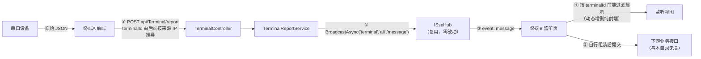

# Application/Service/TerminalContext — 串口测试实时监听

> 本文件是该目录的**协作入口文档**。接手前请先读完，即可掌握：这条链路解决什么问题、后端职责边界在哪、为什么它不用 DataSheet 那套轮询设施。
>
> 最后更新：基于 `bc627f0`，串口监听链路首次落地。

---

## 1. 一句话定位

**把终端 A 的串口原始报文实时转发给所有监听端（终端 B）。后端只做转发，不解析、不落库、不做业务加工。**

监听端收到数据后自行组装，再提交到下游业务接口（如 DIN 耐磨的 `POST api/AbrasionResistanceReport/report`）——那一步与本目录无关。

## 2. 目录内容总览

| 文件 | 类型 | 生命周期 | 职责 |
|---|---|---|---|
| `ITerminalReportService.cs` | 接口 | — | 上报处理 + 活跃终端查询 |
| `TerminalReportService.cs` | 实现 | **Singleton**（`ISingletonDependency`） | 记活跃终端、广播上报事件 |

跨目录关联：

| 文件 | 位置 | 说明 |
|---|---|---|
| `TerminalReportDto` | `src\Application\Contract\DTOs\TerminalContext\` | 上报载荷契约（`TerminalId?` / `Timestamp?` / `Payload`） |
| `TerminalController` | `src\Web API\TerminalController.cs` | `POST api/Terminal/report` + `GET api/Terminal/stream` |
| **前端对接说明** | `doc\guides\TerminalSseFrontendHandoff.md` | 可直接转发给前端 Agent |

## 3. 链路与职责边界

**边界约定**（改动时不要越界）：

| 事项 | 归属 |
|---|---|
| 串口原始报文的**内容解析** | 前端（后端不认得任何设备字段） |
| **哪些终端显示、显示成什么样子** | 前端（后端不维护 per-terminal 订阅关系） |
| 组装成下游业务 DTO 并提交 | 前端 → 下游业务接口 |
| 报文实时转发、终端在线状态 | **本目录** |

## 4. 方法契约

### `TerminalReportService`

| 成员 | 入参 | 返回 | 异常 / 备注 |
|---|---|---|---|
| 构造函数 | `ISseHub hub`、`ILogger<TerminalReportService> logger` | — | 任一为 null 抛 `ArgumentNullException` |
| `ReportAsync` | `TerminalReportDto dto`、`string? sourceIp`、`CancellationToken ct` | `Task<Result>` | **不抛业务异常**，三种失败均返回 `Result.Fail` 带可读原因：① `dto` 为 null；② `Payload.ValueKind == Undefined`；③ 既无 `TerminalId` 又无法解析来源 IP |
| `GetActiveTerminals` | — | `IReadOnlyList<string>` | 返回 5 分钟内上报过的终端（`ActiveTerminalTtl`），按 `StringComparer.Ordinal` 排序；读取时顺带清理过期项 |

### 公开常量（Controller 与前端文档共用，单一来源）

| 常量 | 值 | 用途 |
|---|---|---|
| `Channel` | `"terminal"` | 推送频道 |
| `BroadcastKey` | `"all"` | 固定 key（单连接订阅全部方案） |
| `MessageEvent` | `"message"` | 上报事件名 |
| `ReadyEvent` | `"ready"` | 首帧就绪事件（携带活跃终端列表） |
| `HeartbeatEvent` | `"heartbeat"` | 心跳事件 |
| `HeartbeatInterval` | `15s` | 心跳间隔（与 `DataSheetController` 的 SSE 端点一致） |
| `ActiveTerminalTtl` | `5min` | 在线判定窗口 |

## 5. ⚠️ 复用边界：为什么不用 DataSheet 那套设施

| 通用设施 | 本链路是否使用 | 原因 |
|---|---|---|
| `ISseHub` / `SseHub` | ✅ 用（仅 `RegisterAsync` / `UnregisterAsync` / `BroadcastAsync`） | 连接管理、dead 清理、SSE 传输全部复用 |
| `ISseClient` / `HttpResponseSseClient` / `SseResponseConfigurator` | ✅ 用 | 传输层零重复实现 |
| `IProgressSnapshotProvider` | ❌ **不用** | 那是「状态快照」模型（取当前值 + 比对是否变化）。串口是**事件流**，没有「当前值」概念 |
| `ProgressPollingService` | ❌ **不用** | 轮询是主动拉取；串口是上报驱动，必须即时推送，不能等 1 秒周期 |
| `ISseHub.HasChanged`（哈希去重） | ❌ **绝对不能用** | 设备可能连发两条**完全相同**的报文，去重会让第二条直接消失，而监听端本应看到两条 |

> 一句话：**DataSheet 是「状态」，串口是「事件」。** 两者共用传输层，但不共用派发模型。

## 6. 关键实现细节（改动前必读）

1. **终端标识优先用 IP**：`TerminalId` 为空时取 `sourceIp`。`sourceIp` 由 Controller 的 `ResolveClientIp()` 解析并已做 `IsIPv4MappedToIPv6 → MapToIPv4()` 规范化——不做这步会让 `::ffff:10.0.0.5` 与 `10.0.0.5` 算成两个不同 key，表现为**静默收不到**。
2. **活跃集合用进程内 `ConcurrentDictionary`**，不用 `IDistributedCache`：后者不支持枚举 key，拿不到「当前有哪些活跃终端」，而 `ready` 首帧正需要这份列表。
3. **懒清理**：本服务无后台回收任务，`GetActiveTerminals()` 读取时顺带 `TryRemove` 过期项。字典规模上限 ≈ 历史出现过的终端数，可接受。
4. **先记活跃再广播**：即使无人订阅（广播无接收方），该终端的「在线」状态也应成立。
5. **`Payload` 原样透传**：不序列化再解析、不重命名字段。监听端要靠设备原始字段名做映射。
6. **不落库**：无人订阅时数据直接丢弃，这是「实时监听」的固有语义。

## 7. 已知限制与风险登记

| # | 限制 | 状态 | 说明 |
|---|---|---|---|
| 1 | **无鉴权** | ⚠️ 已确认搁置 | 任何能访问该地址的机器都可伪造上报、也可订阅任意终端数据。代码中已标 `// TODO(鉴权)`；待 user 聚合根重构后统一接入 |
| 2 | **不支持多副本** | ⚠️ 已登记 | 活跃集合是进程内字典，`ISseHub` 连接表亦然。多副本时「副本 A 的订阅收不到副本 B 的广播」+「在线列表各副本不一致」。改造清单见 `src\Application\Service\Realtime\AGENTS.md` §6 |
| 3 | **无历史回放** | 设计如此 | 连上之前的数据收不到；浏览器重连后只拿到新的 `ready` + 后续事件 |
| 4 | **无服务端节流** | 设计如此 | 天平事件级、长会话约 30s 一次，频率低；突发合批由前端在 50~100ms 窗口内完成 |
| 5 | **IP 作为标识的固有局限** | 已知 | DHCP 换 IP 后即视为新终端；NAT 后多台机器会共用同一标识（内网直连场景一般不发生） |

## 8. 修改日志

| 基线 | 变更 |
|---|---|
| `bc627f0` | 新建目录与整条链路：`TerminalReportDto`（契约）、`ITerminalReportService` / `TerminalReportService`（Singleton，含 5 分钟活跃终端集合与懒清理）、`TerminalController`（`POST report` + `GET stream`）。采用「单连接订阅全部 + 前端按 terminalId 过滤」方案，使动态增删监听终端不需要重连、不丢帧。复用 `ISseHub` / `HttpResponseSseClient` / `SseResponseConfigurator`，未新增任何推送设施。 |

## 9. 未来优化方向 / 待确认项

1. **鉴权**：随 user 聚合根重构接入。届时需明确「哪些账号可订阅哪些终端」——当前连「越权」都无从判定。
2. **多副本支持**：若上线多副本，本目录需与 `Realtime` 的改造同步（活跃集合外置 Redis + 广播走 backplane）。
3. **终端标识升级**：若 IP 不够用，可改为前端显式传稳定设备 ID（需解决来源可信问题，否则更易伪造）。
4. **动态订阅（方案 B）**：当前所有监听连接收到全量数据。若终端数量上到几十上百台，可给 `SseHub` 加 `clientId` 反向索引 + 订阅调整接口，实现精准派发。当前量级下不值得。
5. **上报频控**：若将来出现高频设备（如每秒多条），需在前端合批之外增加服务端保护。
