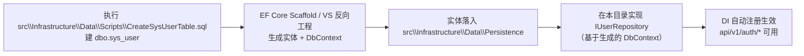

# Infrastructure/Data/Repositories/UserRepos — 用户持久化适配器（待实现）

> 本文件是该目录的**协作入口文档**。读完即可掌握：本目录当前状态、为什么还没有实现、
> 补实现时需要覆盖哪些端口方法、以及必须遵守的隔离约定。
>
> 最后更新：删除手写 SQL 实现，改为等待反向工程生成模型后再补。

---

## 1. 目录当前状态

**本目录目前没有实现文件。**

| 事项 | 状态 |
|---|---|
| `IUserRepository` 端口 | ✅ 已定义，位于 `src\Domain\Aggregeates\UserContext\IUserRepository.cs` |
| 本目录的实现类 | ❌ **已删除**（原先是手写参数化 SQL 的实现） |
| DI 注册 | ❌ 无实现 ⇒ `IUserRepository` 解析失败 |
| `api/v1/auth/*` | ❌ 运行时不可用（注入 `AuthAppService` 时会因缺少 `IUserRepository` 抛异常） |

---

## 2. 为什么删掉手写 SQL 实现

用户的工作流是：**先建表 → 用反向工程把数据库模型迁移到后端 → 再按生成的模型写数据访问层**。

手写 SQL 的仓储违反了这个流程：它绕开生成模型直接和表打交道，等于把表结构硬编码进代码，
后面反向工程出来的模型反而用不上。因此这里要先空着，等模型生成后再补。

正确顺序：

---

## 3. 补实现时必须覆盖的端口方法

`IUserRepository` 共 8 个方法，签名全部以聚合主键 `UserId` 为标识：

| 方法 | 契约要点 |
|---|---|
| `FindByUserNameAsync(string userName, CancellationToken)` | 按 `user_name` 精确查，未找到返回 null |
| `FindByIdAsync(UserId id, CancellationToken)` | 按主键查；主键落库为 32 位十六进制串 |
| `FindByIdentifierAsync(string identifier, CancellationToken)` | 按「账号 / 工号 / 昵称」任一匹配，账号优先 |
| `ExistsByUserNameAsync(string userName, CancellationToken)` | 判断账号是否存在 |
| `AddAsync(User user, CancellationToken)` | 新增，`PassWord` 必须是哈希值 |
| `UpdatePasswordAsync(UserId id, string passwordHash, CancellationToken)` | 更新密码哈希；目标不存在时应显式失败，不能静默成功 |
| `RegisterLoginFailureAsync(UserId id, int lockThreshold, CancellationToken)` | **原子**自增失败计数，达阈值同时把 `status` 置 0，返回累计次数 |
| `ResetLoginFailureAsync(UserId id, string? lastLoginIp, CancellationToken)` | 失败计数归零并更新登录时间与 IP |

### 3.1 补实现时的两个硬要求

1. **失败计数必须原子**：不能「读出来 +1 再写回去」，否则并发登录会丢计数。
   用 EF 时应走 `ExecuteUpdate` / 单条 SQL，而不是先 `Find` 再改实体的属性。
2. **锁定阈值不能硬编码**：一律取 `UserLoginPolicy.LockThreshold`（当前为 5），
   保证应用层与持久化层用的是同一个常量。

---

## 4. 隔离约定（不要破坏）

- **不要**改 `Domain\Model\LabDbContextSec.cs` 与 `Domain\Model\Entities\User.cs` —— 那是老架构的 EF 映射，已冻结。
- **不要**让本目录的实现依赖老架构的 `User` 实体；新表是 `sys_user`，与老 `[user]` 完全独立。
- 实现类打 `IScopedDependency` 标记即可自动注册，无需手写 `Program.cs`。

---

## 5. 修改日志

| 变更 | 说明 |
|---|---|
| 曾实现手写 SQL 版本 | 基于 `dbo.[user]` 的参数化 SQL，含 `ToStorageKey` 主键序列化与原子失败计数 |
| 删除实现 | 用户要求改为「建表 → 反向工程 → 按生成模型实现」的流程；保留 `IUserRepository` 端口不动 |
| 新建表 | 表名改为 `sys_user`（新架构自有表），建表 DDL 见 `src\Infrastructure\Data\Scripts\CreateSysUserTable.sql` |

---

## 6. 未来优化方向

1. **补实现前 `api/v1/auth/*` 全部不可用**：`IUserRepository` 无 DI 注册，`AuthAppService` 构造时会抛解析异常。这是已知的中间态。
2. 补实现时建议补集成测试：失败计数原子性、锁定阈值边界、主键序列化往返。
3. `RealName` 在 `sys_user` 表里没有对应列（聚合中恒为空串）；若需要展示真实姓名，应另查 `user_profile` 或给 `sys_user` 加列后重新反向工程。
